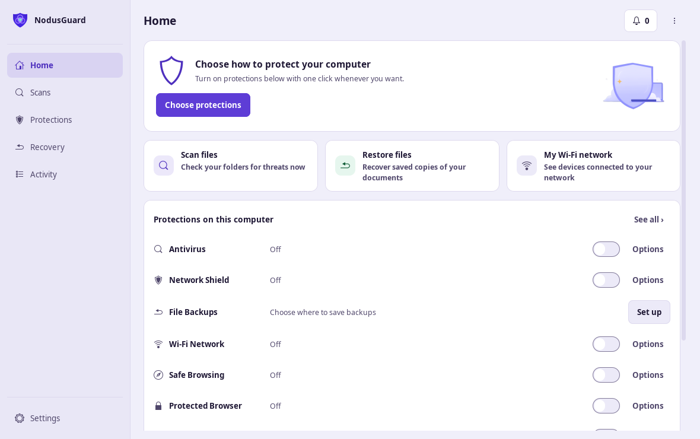
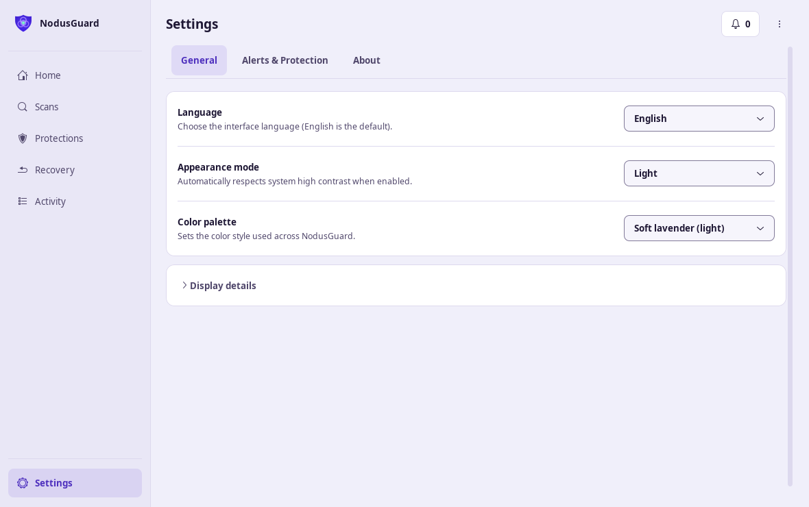
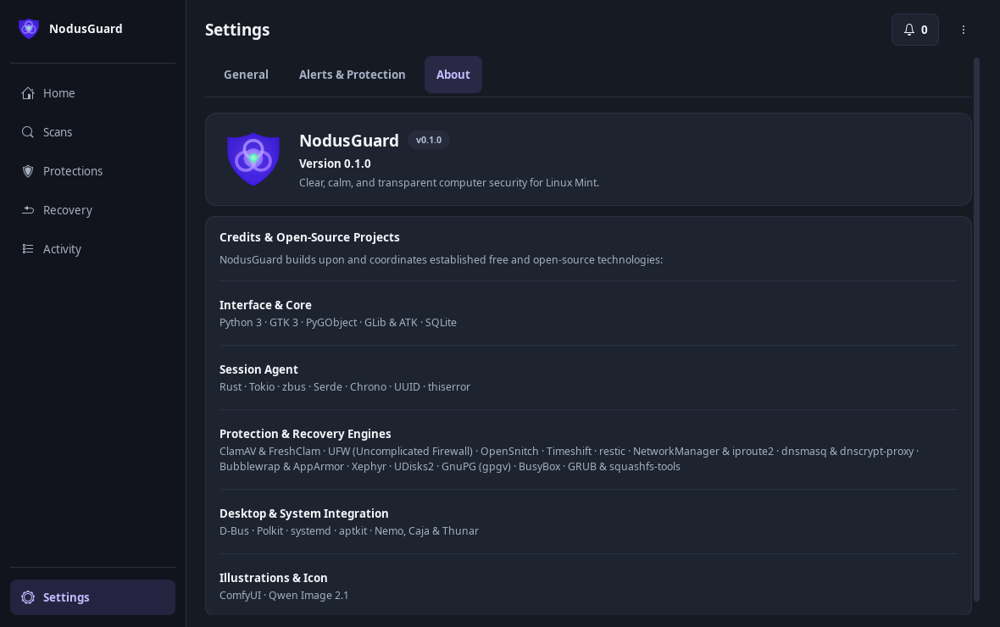

<p align="center">
  
</p>

<h1 align="center">NodusGuard</h1>

<p align="center">
  <strong>Clear, transparent, modular security suite for Linux Mint &amp; Ubuntu 24.04 desktops</strong>
</p>

<p align="center">
  <a href="https://github.com/Grekto-dev/NodusGuard/actions/workflows/ci.yml"></a>
  <a href="https://github.com/Grekto-dev/NodusGuard/releases/tag/v0.2.5"></a>
  <a href="LICENSE"></a>
  
</p>

---

**NodusGuard** brings antivirus scanning, incoming/outgoing firewalling, encrypted file backups, local Wi-Fi device inventory, local DNS phishing/malware filtering, isolated browser sandboxing, and offline rescue media into one cohesive GTK 3 desktop experience.

Instead of inventing proprietary black-box daemons, NodusGuard orchestrates proven free software tools behind explicit confirmations, strict Polkit authorization boundaries, and an approachable flat-design interface.

## Highlights

- **Approachable by default**: Turn individual protections on or off with single-click switches from Home or Protections; detailed parameters stay tucked inside per-module views and collapsible sections.
- **Bilingual live UI**: Starts in **English** by default and switches live to **Brazilian Portuguese (`pt_BR`)** from **Settings → General → Language** without restarting.
- **Native flat aesthetic**: Uses server-side window decorations (SSD), adaptive light (lavender / neutral) and dark flat palettes, automatic high-contrast fallback (omitting custom CSS), full ATK keyboard/Orca accessibility, and **0 idle repaints**.
- **Full scan control**: Pause and resume active antivirus scans (`SIGSTOP`/`SIGCONT` with pause-adjusted ETA) and choose an immediate post-scan power action (**Do nothing**, **Suspend PC**, or **Shut down PC**) with a configurable default in Settings.
- **Smart recommendations & firewall app exceptions**: Apply recommended protections in one click from Home, and allow LAN/companion apps such as **KDE Connect** and **AudioRelay** (or custom ports and UFW profiles) safely scoped to your local network.
- **Safe & reversible actions**: Deactivating any protection preserves existing user backups, quarantined files, and external firewall rules. Destructive operations require non-cached Polkit elevation.
- **Modular Debian packaging**: Core UI and daemon are separate from the 7 optional protection packages and desktop file-manager integrations (Nemo, Caja, Thunar).

## Screenshots

| Home (Light Lavender) | Settings & Language Selector |
|---|---|
|  |  |

| Settings → About (Dark Theme) |
|---|
|  |

## Modular Protections

NodusGuard coordinates 7 independent modules, each packaged separately and backed by established upstream tools:

| Module | Underlying Engines | Optional Package | Purpose |
|---|---|---|---|
| **Antivirus** | `ClamAV` + `FreshClam` | `mint-security-suite-antimalware` | Unprivileged on-demand/scheduled scans and confirmed quarantine with collision resolution |
| **Network Shield** | `UFW` + `OpenSnitch` | `mint-security-suite-firewall` | Incoming firewall with essential rule safety + per-app outbound rules and APT SHA-256 trust cache |
| **File Backups** | `restic` + `Timeshift` | `mint-security-suite-backup` | Encrypted backups, system restore points, and out-of-`$HOME` incident preservation |
| **Wi-Fi Network** | `NetworkManager` + `iproute2` | `mint-security-suite-network` | Local ARP/DHCP device observation (`CAP_NET_RAW`) with client-isolation detection |
| **Safe Browsing** | `dnsmasq` / `dnscrypt-proxy` | `mint-security-suite-browsing` | Local DNS blocking for phishing/malware/miners with split-VPN preservation and DoH checks |
| **Protected Browser** | `bubblewrap` + `AppArmor` | `mint-security-suite-isolation` | AppArmor status, disposable isolated browser profiles, and experimental Bank Mode |
| **Emergency USB** | `UDisks2` + `GnuPG` + `GRUB` | `mint-security-suite-rescue` | GPG-verified offline rescue ISO creation and exclusive USB imaging (`O_EXCL`) |

File manager context-menu integrations (`Previous versions…`):
- `mint-security-suite-nemo` (Cinnamon / Nemo)
- `mint-security-suite-caja` (MATE / Caja)
- `mint-security-suite-thunar` (Xfce / Thunar)

## Installation (`.deb` Packages)

Download the release packages and `SHA256SUMS.txt` from [GitHub Releases](https://github.com/Grekto-dev/NodusGuard/releases):

```bash
# 1. Verify package integrity
sha256sum -c SHA256SUMS.txt

# 2. Install the core package (GTK 3 panel, D-Bus core, Rust session agent, C helpers)
sudo apt install ./mint-security-suite-core_0.2.5_amd64.deb

# 3. Install the protection modules and file manager integrations you want
sudo apt install \
  ./mint-security-suite-antimalware_0.2.5_all.deb \
  ./mint-security-suite-firewall_0.2.5_all.deb \
  ./mint-security-suite-backup_0.2.5_all.deb \
  ./mint-security-suite-nemo_0.2.5_all.deb
```

Then launch **NodusGuard** from your application menu or run `mint-security-suite` in a terminal.

## Building from Source

### Prerequisites (Linux Mint 22.x / Ubuntu 24.04)

```bash
sudo apt update
sudo apt install -y \
  build-essential gcc make dpkg-dev pkg-config \
  python3 python3-gi python3-gi-cairo python3-pil python3-dbus \
  gir1.2-gtk-3.0 gir1.2-atk-1.0 gir1.2-gdkpixbuf-2.0 \
  xserver-xephyr xvfb dbus-x11 at-spi2-core adwaita-icon-theme gnome-themes-extra \
  ufw bubblewrap
```

Install a recent Rust toolchain (`rustc` / `cargo` via [rustup](https://rustup.rs/)).

### Build, Test & Package

```bash
# Build native C11 helpers and Rust session agent
make helpers
make build-agent

# Run C helper self-tests, Rust tests, and full Python + GTK/Xephyr test suite
make test

# Run H8 GTK verification (contrast, ATK accessibility, viewports, zero idle repaints)
make h8

# Run the desktop UI directly from the source tree
PYTHONPATH=src ./bin/mint-security-suite

# Build all 11 modular .deb packages into dist/
make deb
```

## Documentation

- [Architecture Overview](docs/architecture.md)
- [Homologation Report (H1–H8)](docs/homologation-report.md)
- [Release Manifest (`0.2.5`)](docs/release-manifest.json)
- [Security Policy](SECURITY.md)
- [Contributing Guide](CONTRIBUTING.md)
- [Changelog](CHANGELOG.md)

## Credits & Open-Source Projects

NodusGuard is built on top of open-source software across its stack:

- **Interface & Core**: Python 3, GTK 3, PyGObject, GLib & ATK, SQLite
- **Session Agent**: Rust, Tokio, zbus, Serde, Chrono, UUID, thiserror
- **Protection & Recovery Engines**: ClamAV & FreshClam, UFW, OpenSnitch, Timeshift, restic, NetworkManager & iproute2, dnsmasq & dnscrypt-proxy, Bubblewrap & AppArmor, Xephyr, UDisks2, GnuPG (`gpgv`), BusyBox, GRUB & `squashfs-tools`
- **Desktop & System Integration**: D-Bus, Polkit, systemd, aptkit, Nemo, Caja & Thunar
- **Visual Assets**: ComfyUI & Qwen Image 2.1

## License

Released under the [GNU General Public License v3.0 or later](LICENSE) (`GPL-3.0-or-later`).
